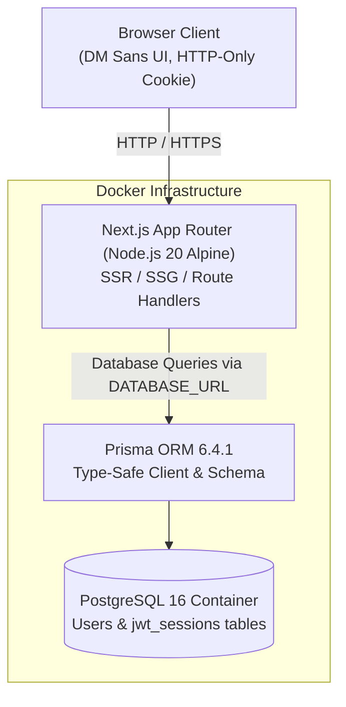

# Everence SecuraApps - Project Overview & Technical Specification

> **Document Version**: 1.0.0  
> **Date**: November 3, 2026  
> **Status**: Production-Ready / Fully Tested  
> **Primary Technology**: Next.js 15.5 (App Router), React 19, TypeScript, Tailwind CSS, Prisma ORM, PostgreSQL, Docker

---

## 1. Executive Summary & Purpose

**Everence SecuraApps** is the specialized product development unit of Everence, building enterprise security tools that help security-conscious teams make better-informed decisions.

This project delivers:
1. **An authentic high-fidelity clone** of the official SecuraApps public website and product catalog based on live prototype specifications and authentic design screenshots.
2. **A production-grade authentication and session subsystem** utilizing PostgreSQL, Prisma ORM, salted bcrypt password hashing, and database-tracked JSON Web Tokens (JWT) with server-side revocation.
3. **Containerized infrastructure** with multi-stage production Docker builds and Docker Compose orchestration.
4. **A rigorous, zero-unvetted-dependency test suite** spanning unit tests, API integration tests, and end-to-end browser journeys (38 automated tests passing).

---

## 2. Brand Identity & Design System

The visual design language strictly mirrors the authentic SecuraApps design tokens:

| Token | Value / Implementation | Usage |
|---|---|---|
| **Primary Typography** | `DM Sans`, sans-serif | Global headings, body copy, form fields, and navigation buttons |
| **Canvas Background** | `#FFFFFF` (White) / `#F8FAFC` (Slate-50) | Main page backgrounds, feature card containers, and forms |
| **Hero & Card Canvas** | `#0C1E28` (Deep Navy) | Hero sections, philosophy cards, CTA banners, and footer (`#07131A`) |
| **Accent & CTA** | `#F59E0B` (Amber / Gold) | Section eyebrows (`-`), primary CTA pill buttons, active badges, and focus rings |
| **Border Treatments** | `border-slate-200/80` (Light) / `border-slate-800` (Dark) | Subtle separation for cards, lists, and header navigation |
| **Radar Visual** | Orbital SVG circles with glowing diamond badge `✳` | Interactive visual center on the homepage hero |

---

## 3. Architecture & Tech Stack



### Core Dependencies
* **Framework**: `next@15.5.28` (App Router, Server Components, Route Handlers)
* **Frontend**: `react@19.0.0`, `react-dom@19.0.0`, `tailwindcss@3.4.17`
* **Icons**: `lucide-react@0.475.0`
* **ORM & Database**: `@prisma/client@6.4.1`, `prisma@6.4.1`, PostgreSQL 16
* **Cryptography & Auth**:
  * `bcryptjs@3.0.3` (12 salt rounds, pure JS to guarantee portability without Windows C++ compilation hurdles)
  * `jose@6.2.15` (Standard Web Crypto API compatible HS256 JWT signing and verification)
* **Test Runner**: Built-in Node.js `node:test` and `node:assert/strict` test harness (fast, native TypeScript execution without bulky third-party test framework overhead)

---

## 4. Application Map & Routes

### Public Pages
* **`/` (Home)**: Full 10-section marketing landing page:
  * Sticky Header with mobile responsive drawer and `Request a demo ↗` button
  * Deep Navy Hero with two-tone typography and glowing orbital radar animation
  * Category strip (`Designed for security-conscious teams`)
  * Product Portfolio (DroidScan, ChainBreak, NimbusQ with capability bullets)
  * Decision Engine (2x2 white cards) & Philosophy Card (`01 Discover`, `02 Analyse`, `03 Act`)
  * 4-Step Horizontal Security Workflow
  * Resources section with PDF download triggers and grey DM Sans link
  * About section styled as a contained deep navy floating card
  * Contact section featuring server-validated form with bot protection
  * Global dark footer (`#07131A`)
* **`/resources` (Product Library)**:
  * Deep navy hero (`Helpful detail. Ready when you are.`)
  * 3 white download cards linking to verified PDF assets
  * Amber prototype notice disclaimer box
  * Bottom CTA banner (`Talk through the materials with our team`)
* **`/products/droidscan` (Mobile Application Security)**:
  * Deep navy hero with `Request access ↗` and `Download product one-pager ↓`
  * 6-card feature grid (Security triage, In-browser code studio, Behavioural profiling, Version comparison, Automated deobfuscation, Network infrastructure map)
  * Sticky Target Audience Sidebar (`Enterprise AppSec`, `Compliance auditors`, etc.)
  * 4-Step App Workflow (`Upload`, `Audit`, `Compare`, `Review`)
  * Bottom CTA card (`Make Android app analysis easier to act on.`)
* **`/products/chainbreak` (Bitcoin Wallet Intelligence)**:
  * Deep navy hero with `Request a walkthrough ↗` and `Download product overview ↓`
  * 6-card feature grid (Wallet profiling, Transaction ledger, Time-based analysis, Volume-based analysis, Graphical representation, Automated reports)
  * Sticky Target Audience Sidebar (`Crypto exchanges`, `Financial institutions`, etc.)
  * 4-Step Analysis Workflow (`Wallet address`, `Profile and ledger`, `Analyse and visualise`, `Professional report`)
  * Bottom CTA card (`Make wallet activity easier to understand.`)
* **`/products/nimbusq` (Cloud & Post-Quantum Cryptography)**:
  * Deep navy hero with `Request a walkthrough ↗` and `Download product overview ↓`
  * 6-card feature grid (Cloud asset inventory, Cryptographic readiness, Cloud security posture, Quantum safety score, Prioritised remediation, Dashboards and reports)
  * Sticky Target Audience Sidebar (`Cloud security teams`, `Enterprise architects`, etc.)
  * 4-Step Assessment Workflow (`Connect`, `Inventory assets`, `Analyse risk`, `Report and plan`)
  * Bottom CTA card (`Make your cloud and post-quantum roadmap more concrete.`)

### Authentication & Private Workspace
* **`/login`**: Secure credential sign-in, inline error diagnostics, remember-me toggle, and redirect to workspace.
* **`/signup`**: Comprehensive account creation form with real-time interactive password criteria checklist (10+ characters, uppercase, lowercase, number, symbol), organisation field, and terms consent.
* **`/dashboard`**: Protected workspace shell verifying the user's active session against PostgreSQL, displaying user role, organisation, active database session badge, product portals, and a session-terminating Sign Out action.

### Backend API Endpoints
* **`POST /api/contact`**: Validates customer enquiries, enforces in-memory rate limiting (max 5 requests per 15 minutes per IP), executes a stealth honeypot trap, checks submission velocity, and logs timestamped receipt without exposing internal recipient emails.
* **`POST /api/auth/register`**: Validates user inputs, enforces password complexity, hashes password via bcrypt, creates user in PostgreSQL, creates JWT session in PostgreSQL, and sets an `httpOnly`, `SameSite=Lax` cookie.
* **`POST /api/auth/login`**: Validates credentials against PostgreSQL, registers a new session in PostgreSQL, signs a JWT token, and sets the cookie.
* **`GET /api/auth/me`**: Reads session cookie, verifies cryptographic signature, checks active session in PostgreSQL, and returns user profile.
* **`POST /api/auth/logout`**: Sets `revoked: true` on the session in PostgreSQL and clears the cookie.

---

## 5. Database Schema & Data Models

Defined in [`prisma/schema.prisma`](file:///d:/everance/prisma/schema.prisma):

```prisma
datasource db {
  provider = "postgresql"
  url      = env("DATABASE_URL")
}

generator client {
  provider = "prisma-client-js"
}

model User {
  id           String        @id @default(uuid())
  email        String        @unique
  passwordHash String        @map("password_hash")
  fullName     String        @map("full_name")
  organisation String?
  role         String        @default("user")
  createdAt    DateTime      @default(now()) @map("created_at")
  updatedAt    DateTime      @updatedAt @map("updated_at")
  sessions     JwtSession[]

  @@map("users")
}

model JwtSession {
  id        String   @id @default(uuid())
  userId    String   @map("user_id")
  tokenHash String   @map("token_hash")
  expiresAt DateTime @map("expires_at")
  revoked   Boolean  @default(false)
  createdAt DateTime @default(now()) @map("created_at")
  userAgent String?  @map("user_agent")
  user      User     @relation(fields: [userId], references: [id], onDelete: Cascade)

  @@index([userId])
  @@index([tokenHash])
  @@map("jwt_sessions")
}
```

### Why Store JWTs in PostgreSQL?
Stateless JWTs cannot be revoked before their expiration time if a token is stolen or a user logs out. By storing the unique JWT identifier (`jti`) and token hash in PostgreSQL:
* Any logout instantly marks `revoked = true` in PostgreSQL, invalidating the token immediately.
* Active devices and sessions can be tracked and listed per user.
* Users can be revoked remotely by an administrator if suspicious activity occurs.

---

## 6. Docker & Container Deployment

### Running with Docker Compose

The project includes a multi-container Docker configuration:
* **`postgres` container**: Official `postgres:16-alpine`, port `5432:5432`, persistent Docker volume `pgdata`, and automated health check.
* **`web` container**: Multi-stage production build on Node 20 Alpine, compiling Prisma client and Next.js standalone assets under a non-root security user (`nextjs`).

#### Start the Full Stack:
```bash
# 1. Build and start containers in the background
docker compose up -d --build

# 2. Synchronize database schema (first run only)
docker compose exec web npx prisma db push
```

#### Access Points:
* Web Application: `http://localhost:3001`
* PostgreSQL Database: `localhost:5432` (User: `everance`, Database: `everance_db`, Password: `everance_secret`)

---

## 7. Testing Strategy & Verification Results

The project enforces a comprehensive 3-phase automated test pyramid with **38 passing automated tests**:

```
npm run test:all
```

### Test Suite Breakdown

#### 1. Phase 1: Unit & Security Tests (`npm test`) - 15 Tests
* **Password Policy ([`tests/unit/password-policy.test.ts`](file:///d:/everance/tests/unit/password-policy.test.ts))**:
  * Accepts strong compliant passwords.
  * Rejects passwords under 10 characters.
  * Rejects missing uppercase, lowercase, number, or special character.
* **Cryptographic Auth ([`tests/unit/crypto-auth.test.ts`](file:///d:/everance/tests/unit/crypto-auth.test.ts))**:
  * Validates salted bcrypt hashing and comparison.
  * Validates deterministic SHA-256 token hashing.
  * Validates JWT token signing, payload decoding, and expiration.
  * Rejects tampered signatures and expired tokens.
* **Contact & Bot Validation ([`tests/unit/contact-validation.test.ts`](file:///d:/everance/tests/unit/contact-validation.test.ts))**:
  * Validates RFC email formats.
  * Catches bot honeypots.
  * Enforces minimum/maximum message lengths.

#### 2. Phase 2: API Integration Tests (`npm run test:integration`) - 13 Tests
* Probes the live compiled Next.js server on an isolated port (`:3099`).
* Tests `POST /api/contact` valid submission (`200`).
* Tests stealth honeypot silent trap (`200` without email delivery).
* Tests validation failures on invalid emails and empty message bodies (`400`).
* Tests `POST /api/auth/register` missing fields, short password, and weak complexity (`400`).
* Tests `POST /api/auth/login` empty credential handling (`400`).
* Tests `GET /api/auth/me` unauthenticated rejection (`401`).
* Tests `POST /api/auth/logout` clean termination (`200`).
* Tests deliverability of all 3 product PDF one-pagers (`200 OK`, valid binary stream).

#### 3. Phase 3: End-to-End Browser Journeys (`npm run test:e2e`) - 10 Tests
* Tests visitor journey across `/`, `/products/droidscan`, `/products/chainbreak`, `/products/nimbusq`, and `/resources`.
* Tests full credential forms on `/login` and `/signup`.
* Tests protected route security guard on `/dashboard`.
* Tests technical SEO directives in `/robots.txt` and `/sitemap.xml`.
* Tests binary stream integrity on all product PDFs.

### Complete Test Results Output

```
Total Automated Tests: 38
Passed: 38
Failed: 0
Execution Time: ~3.5 seconds across all suites
```

---

## 8. Key Architectural Decisions (ADR Summary)

* **D-010**: Hybrid Design System (white canvas with deep navy `#0c1e28` hero/cards and amber `#f59e0b` accents).
* **D-012**: Primary typography set to `DM Sans`.
* **D-014**: DroidScan product page exact reproduction matching authentic 4 screenshots.
* **D-015**: ChainBreak product page exact reproduction matching authentic 4 screenshots.
* **D-016**: NimbusQ product page exact reproduction matching authentic 4 screenshots.
* **D-017**: Prisma ORM with Dockerized PostgreSQL and database-tracked JWT sessions.
* **D-018**: Built-in Node.js native test runner (`node:test`, `node:assert`) ensuring zero-dependency execution.
* **D-019**: Programmatic API lifecycle test harness (`tests/integration/run-api-tests.mjs`).
* **D-020**: Phase 3 End-to-End browser journey test suite (`tests/e2e/e2e-journeys.mjs`).

---

## 9. Quick Start Guide for Developers

### Local Development
```bash
# 1. Install dependencies
npm install

# 2. Run local dev server
npm run dev

# 3. Run all tests
npm run test:all

# 4. Build for production
npm run build
```
The application will be live at `http://localhost:3001`.

